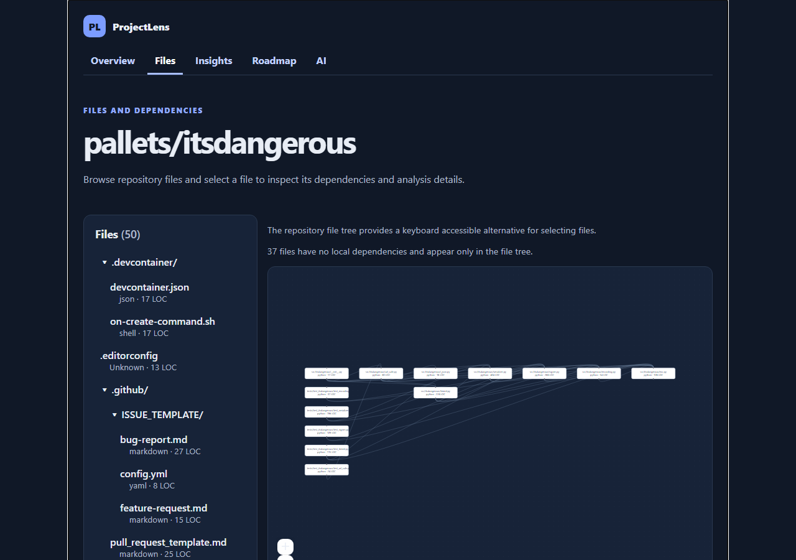
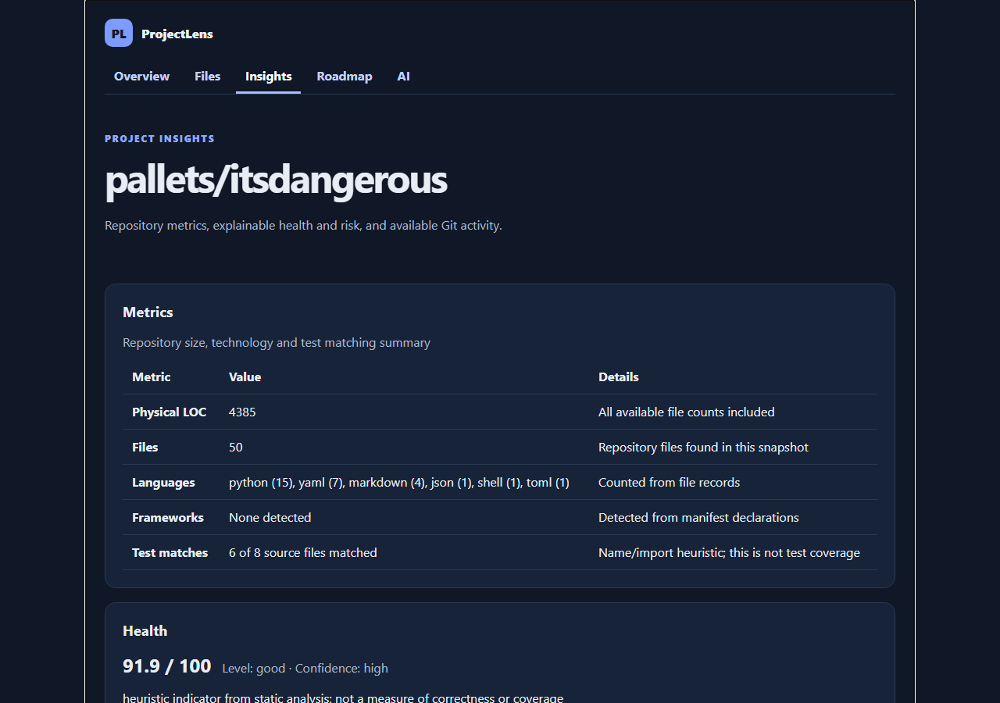
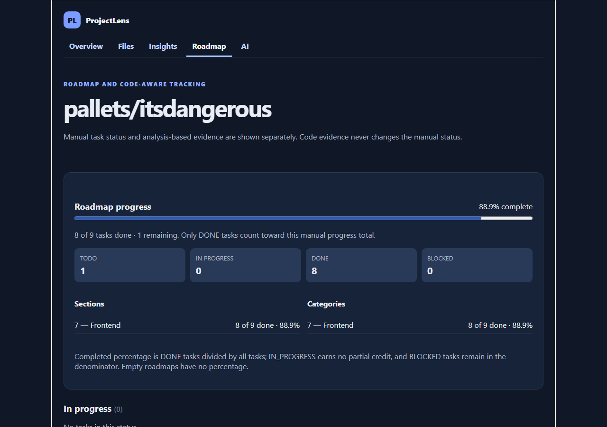
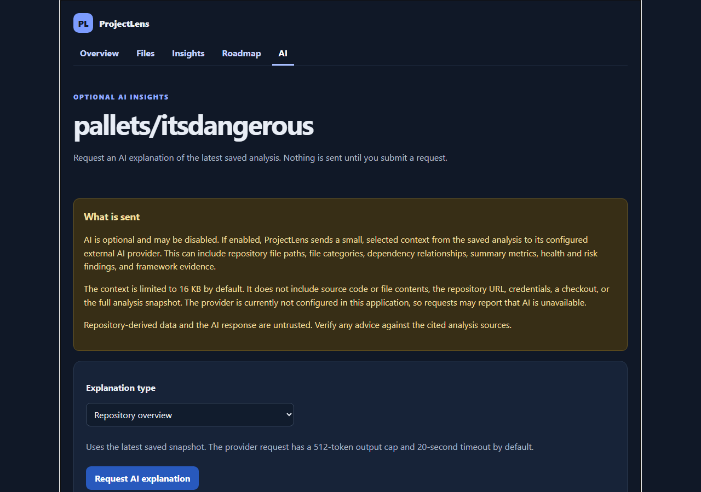

# ProjectLens frontend

Small React, TypeScript, and Vite client foundation. The Vite dev server proxies `/api` to `http://localhost:8000`; set `VITE_API_BASE` to override the API prefix (default `/api/v1`).

```sh
npm install
npm run dev
npm run build
npm test
```

The API must be running separately. See the repository README for backend setup. Tests use Vitest, jsdom, and Testing Library.

## Using the app

Start the API (see the repository README), then run `npm run dev` and open the printed local URL (usually http://localhost:5173). The interface is in Turkish.

1. On **Projeleriniz**, paste a public GitHub repository URL (`https://github.com/owner/repository`) and choose **Proje ekle**. Analysis runs in the background; the list updates when it finishes. Choose **Sil** on a project card or **Projeyi sil** on its overview and confirm to remove a project.
2. Open a project to see **Genel Bakış**: a health verdict, risk level, three priority concerns and cards linking to the other views. The shared project header shows the repository, latest analysis time and status. Use the project navigation to switch views:
   - **Dosyalar**: collapsible file tree, dependency graph grouped by folder (cycle members labelled) and a details panel beside the graph on wide screens. The tree is the keyboard accessible alternative to the graph, which shows at most 120 connected files. Selecting an omitted connected file brings it into the graph.
   - **Analizler**: metrics, health score components, ranked risks and Git activity. These are static heuristics, not defect predictions; unavailable data is labelled in Turkish.
   - **Yol Haritası**: status groups with counts and priority badges. Each task has a short code assessment summary; expand it for reasons and criteria. Import tasks through the API (see the repository README); status changes are saved immediately.
   - **Yapay Zeka**: optional explanations. Nothing is sent until you request an explanation, and results are advisory. It requires an AI provider to be configured on the server.

Navigation uses URL hashes (`#/projects/1/files`), so the app works from any static file server. Set `VITE_API_BASE` at build time if the API is not served under `/api/v1`.

The layout adapts to narrow screens and the system light/dark preference, and respects reduced motion. `src/i18n.ts` maps analyzer enums, known backend sentence templates and API error codes to Turkish. Unknown analyzer text and unknown error messages retain the original wording; repository-authored text and arbitrary AI prose are not machine translated. Add mappings and contract tests when the analyzer introduces new messages.

## Screenshots

Captured from a real analysis of a public repository before the current layout update (dark theme follows the system preference).

| Files and dependencies | Insights |
| --- | --- |
|  |  |
| **Roadmap** | **AI (optional)** |
|  |  |

Project list and overview: [list](../docs/screenshots/projects.png), [overview](../docs/screenshots/projects-1.png).
